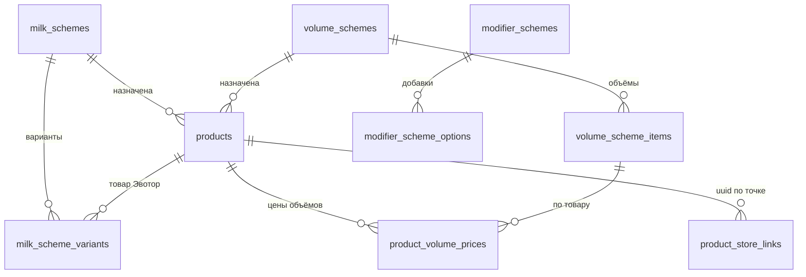

# Конфигурация товара: объёмы, молоко, добавки

## 1. Назначение

Три **независимых** набора настроек товара, которые касса получает вместе с каталогом:

| Схема | Что задаёт | Обязателен ли выбор | Где хранится |
|---|---|---|---|
| Объёмы | шаблон набора объёмов (200/300/400 мл); цены — в карточке товара | **да** (`selectionRequired: true`) | `volume_schemes` + `volume_scheme_items` + `product_volume_prices` |
| **Молоко** | обычное (бесплатно, без чека) и платные варианты (товар Эвотор) | **да** (`selectionRequired: true`) | `milk_schemes` + `milk_scheme_variants` |
| Добавки | сиропы/топпинги, лимиты, обязательность по группам | нет (`selectionRequired: false`) | `modifier_schemes` + `modifier_scheme_options` (без изменений) |

Три сущности **независимы**: у каждой свои таблицы, свой CRUD-раздел в админке и своё поле в карточке товара
(«Схема объёмов», «Схема молока», «Схема добавок»). Ни одно назначение не обязательно; обязательность
возникает только **внутри** назначенной схемы.

Кассы старого образца продолжают работать: объёмы по-прежнему есть в `product_groups` (variant-строки),
новая схема объёмов — дополнительный слой, который не меняет существующую модель.

## 2. Архитектура

```mermaid
flowchart LR
  V[Админка · Схемы объёмов] -->|POST /api/admin/volume-schemes| B[(SQLite)]
  M[Админка · Схемы молока] -->|POST /api/admin/milk-schemes| B
  A[Админка · Схемы добавок] -->|POST /api/admin/modifier-schemes| B
  Admin[Карточка товара] -->|volumeSchemeId / milkSchemeId / modifierSchemeId| B
  PWA[Касса APK] -->|GET /api/devices/catalog?storeUuid| B
  B -->|products[].config = volumes / milk / addons| PWA
```

## 3. Схема БД



| Таблица / колонка | Тип | Смысл |
|---|---|---|
| `milk_schemes.id` | INTEGER PK | схема |
| `milk_schemes.name` | TEXT | название для админа |
| `milk_schemes.active` | INTEGER | выключенная схема не отдаётся кассе |
| `milk_scheme_variants.scheme_id` | FK → `milk_schemes.id` (CASCADE) | принадлежность |
| `milk_scheme_variants.product_id` | FK → `products.id` | товар Эвотор (UUID берётся по точке) |
| `milk_scheme_variants.label` | TEXT | «Обычное молоко», «Кокосовое» |
| `milk_scheme_variants.is_default` | INTEGER | один на схему |
| `milk_scheme_variants.is_free` | INTEGER | бесплатный вариант (обычное молоко) |
| `milk_scheme_variants.send_to_receipt` | INTEGER | пробивать отдельной позицией |
| `milk_scheme_variants.sort_order`, `active` | INTEGER | порядок и видимость |
| `products.milk_scheme_id` | INTEGER NULL | назначенная схема |

| Таблица / колонка (объёмы) | Тип | Смысл |
|---|---|---|
| `volume_schemes.id`, `name`, `active` | INTEGER/TEXT | шаблон объёмов, выключенный не отдаётся кассе |
| `volume_scheme_items.scheme_id` | FK → `volume_schemes.id` (CASCADE) | принадлежность |
| `volume_scheme_items.label` | TEXT | «200 мл» — то, что видит бариста |
| `volume_scheme_items.size_value`, `size_unit` | INTEGER/TEXT | 200 / `ml` (nullable: можно без числа) |
| `volume_scheme_items.sort_order`, `active` | INTEGER | порядок; первый активный — предвыбранный |
| `product_volume_prices.product_id` + `item_id` | PK, FK | цена объёма у конкретного товара |
| `products.volume_scheme_id` | INTEGER NULL | назначенная схема объёмов |

**Цена живёт на товаре, а не в схеме**: один шаблон «Стандарт 200/300/400 мл» обслуживает и капучино,
и латте, у каждого свои цены. Нет строки в `product_volume_prices` → берётся `products.price`.

**UUID не хранится в схеме**: у товара Эвотор нет одного UUID на все магазины — он резолвится через `product_store_links (product_id, store_uuid, evotor_uuid)` для точки из запроса.

## 4. Миграция и откат

| Миграция | Что делает | Откат |
|---|---|---|
| `039_milk_schemes.sql` | `milk_schemes`, `milk_scheme_variants`, `products.milk_scheme_id` | `rollback/039_milk_schemes_rollback.sql` |
| `040_volume_schemes.sql` | `volume_schemes`, `volume_scheme_items`, `product_volume_prices`, `products.volume_scheme_id` | `rollback/040_volume_schemes_rollback.sql` |

Обе миграции аддитивные (`CREATE TABLE IF NOT EXISTS`, `ALTER TABLE … ADD COLUMN`), применяются раннером
`db/migrate.ts` по алфавиту. Откат — вручную, файлы лежат **вне** `migrations/`, иначе раннер применил бы их как миграции.
Повторный запуск безопасен: `ensureMilkSchemeSchema()` / `ensureVolumeSchemeSchema()` идемпотентны для старых БД.

## 5. Правила

### Обязательность выбора (главное различие схем)

| Ситуация | Касса |
|---|---|
| Схема объёмов не назначена | секции объёма нет, продаётся базовая цена |
| Схема объёмов назначена | объём **обязателен**; первый активный предвыбран |
| Схема молока не назначена | секции молока нет |
| Схема молока назначена | выбор молока **обязателен**, подтверждение без выбора запрещено; обычное молоко предвыбрано автоматически |
| Схема добавок не назначена | секции добавок нет |
| Схема добавок назначена | выбор **необязателен**: ноль, одна или несколько добавок |

### Обычное молоко
- `isFree = true`, `sendToReceipt = false`, обычно `isDefault = true`;
- отображается кассиру, участвует в конфигурации, **в чек не идёт**, цену не меняет;
- даже если у него есть UUID — позиция не пробивается.

### Платное молоко
- `isFree = false`, `sendToReceipt = true`, обязателен `product_id`;
- UUID берётся из связей **этой** точки; при отсутствии — вариант помечается `available: false`, `notReadyReason: "no_evotor_uuid"` (фиктивный UUID не подставляется);
- цену и наименование касса берёт из своей номенклатуры Эвотор.

### Валидация (сервер и клиент)
- один «по умолчанию»; `isFree && sendToReceipt` запрещено; платный без товара запрещён; дубликат товара в двух вариантах запрещён; слабое имя варианта/схемы запрещено;
- удаление схемы, назначенной товарам → 409 (сначала снять назначение или выключить схему);
- права: чтение — любой админ-токен, запись — только `owner` (manager/viewer → 403).

### Формулы чека
\[
P_{\text{чека}} = P_{\text{основного товара}} + P_{\text{платного молока}} + \sum_{i=1}^{n} P_{\text{платной добавки}_i}
\qquad P_{\text{обычного молока}} = 0,\quad \text{sendToReceipt}_{\text{обычного}} = false
\]

## 5.1. Индивидуальная конфигурация карточки (прокси Evotor Cloud)

```http
GET /api/devices/products/{productId}/configuration?storeUuid={storeUuid}
Authorization: Bearer <EVOTOR_PROXY_TOKEN>
X-Evotor-Store-Uuid: {storeUuid}   # опционально, должен совпадать с query
```

- маршрут живёт в существующем пространстве `/api/devices` → маска `https://app\.67coffee\.ru/api/.*` его покрывает;
- **авторизация как у `/catalog`:** APK 5.2.21 (versionCode 147) отправляет только `Accept`,
  `X-Evotor-Store-Uuid`, `X-Evotor-Device-UUID` — без `Authorization`. Поэтому маршрут публичный
  read-only; если `Authorization` всё же передан и не совпал с `EVOTOR_PROXY_TOKEN` → `403 proxy_forbidden`;
- «товар не найден» → `200 { ok: false, error: "product_not_found" }`: `404` у кассы значит
  «маршрута нет» и переключает её на офлайн-окно по каталогу;
- если `?storeUuid=` и `X-Evotor-Store-Uuid` расходятся (APK собирает query из кэша каталога),
  запрос **не отклоняется**: берётся точка, у которой есть связи объёмов товара, в ответ добавляется
  `requestedStoreUuid`, в лог пишется `configuration store mismatch` с short-id обеих точек;
- `Cache-Control: no-store`, лимит 240 запросов в минуту на точку;
- UUID берутся только из `product_store_links` запрошенной точки (fallback на соседнюю точку запрещён);
- объёмы — все реальные SKU группы (или один SKU, если группы нет);
- молоко — `null`, если `products.milk_scheme_id` пуст; иначе `required: true`;
- добавки — `null`, если схема не назначена; `required` в блоке всегда `false`;
- `byProductId` содержит ключ **каждого** объёма: `{ schemeId: null, options: [] }` = схема не назначена
  (касса блок не рисует);
- если схема молока назначена, но вариантов нет — `milk.byProductId[id].error = "empty_scheme"` и
  `configErrors[{ code: "milk_scheme_empty" }]`: обязательный выбор нельзя маскировать под «схемы нет».

Типы: `ProductConfiguration` в `backend/src/modules/catalog/productConfig.ts`;
фикстура контракта — `backend/src/__tests__/fixtures/product-configuration-fixture.json`.

## 5.2. Молоко уходит из схем добавок

Ключ `milk` удалён из словаря групп добавок (`ADDON_GROUP_KEYS = ['syrup','sugar','extra']`),
`withZeroDefaults()` больше не подставляет «Обычное» в схемы добавок. Легаси-строки переносит
идемпотентная функция `migrateMilkFromAddonSchemes()` (`backend/src/modules/catalog/milkFromAddons.ts`)
при старте API:

1. находит `modifier_scheme_options`/`modifier_scheme_items` c `group_key in ('milk','молоко')`;
2. создаёт (или находит по имени `Молоко: <схема добавок>`) схему молока;
3. zero-вариант → бесплатное молоко, вариант с товаром → платное (`sendToReceipt=1`);
4. назначает схему товарам этой схемы добавок, у которых `milk_scheme_id IS NULL`;
5. удаляет перенесённые строки;
6. строки без товара/с несуществующим товаром **не удаляет** — попадают в `report.ambiguous`.

Новая схема добавок с `groupKey: "milk"` отклоняется с 400.

## 6. API

| Метод | Путь | Назначение |
|---|---|---|
| GET | `/api/admin/milk-schemes` | список схем с вариантами и `usedByProducts` |
| POST | `/api/admin/milk-schemes` | создать/обновить (`{ id?, name, active, variants[] }`), варианты заменяются целиком |
| DELETE | `/api/admin/milk-schemes/:id` | удалить (409, если назначена товарам) |
| GET | `/api/admin/volume-schemes` | список схем объёмов с `items` и `usedByProducts` |
| POST | `/api/admin/volume-schemes` | создать/обновить (`{ id?, name, active, items[] }`), объёмы заменяются целиком |
| DELETE | `/api/admin/volume-schemes/:id` | удалить (409, если назначена товарам) |
| POST | `/api/admin/products` | `volumeSchemeId`, `milkSchemeId`, `modifierSchemeId` (число — назначить, `null` — снять, отсутствует — не менять); `volumePrices: [{ itemId, price }]` |
| GET | `/api/devices/products/:productId/configuration` | конфигурация карточки через прокси: объёмы, молоко, добавки |
| GET | `/api/devices/catalog?storeUuid=` | `products[].config = { volumes, milk, addons }` + плоские `volumes[]`, `milk[]`, `toppings[]` |

### Пример ответа каталога (фрагмент)

```json
{
  "id": 42,
  "name": "Капучино",
  "volumeSchemeId": 2,
  "milkSchemeId": 3,
  "config": {
    "volumes": {
      "schemeId": 2,
      "selectionRequired": true,
      "options": [
        { "itemId": 1, "label": "200 мл", "sizeValue": 200, "sizeUnit": "ml", "price": 250, "isDefault": true, "sortOrder": 0 },
        { "itemId": 2, "label": "300 мл", "sizeValue": 300, "sizeUnit": "ml", "price": 320, "isDefault": false, "sortOrder": 1 }
      ]
    },
    "milk": {
      "schemeId": 3,
      "selectionRequired": true,
      "options": [
        { "id": 11, "productId": null, "label": "Обычное молоко", "evotorUuid": null,
          "isDefault": true, "isFree": true, "sendToReceipt": false, "sortOrder": 0,
          "active": true, "available": true, "notReadyReason": null },
        { "id": 12, "productId": 57, "label": "Кокосовое молоко", "evotorUuid": "8f1c…",
          "isDefault": false, "isFree": false, "sendToReceipt": true, "sortOrder": 1,
          "active": true, "available": true, "notReadyReason": null }
      ]
    },
    "addons": { "schemeId": 7, "selectionRequired": false, "options": [ … ] }
  },
  "volumes": [ … ], "milk": [ … ], "toppings": [ … ]
}
```

Схема не назначена → соответствующая группа `config.* = null` (секция на кассе не показывается) и плоский массив `[]`.
Неактивные схемы и варианты не отдаются. Поля `volumes`/`milk`/`toppings` верхнего уровня сохранены для старых сборок APK.

## 7. Обработка ошибок

| Код | Когда |
|---|---|
| 400 | нарушено бизнес-правило (текст по-русски), некорректный id |
| 403 | запись не владельцем |
| 409 | удаление схемы, назначенной товарам |
| 200 | успешное создание/обновление/удаление |

## 8. Совместимость с APK

- Поля `volumeSchemeId`, `volumes`, `milkSchemeId`, `milk`, `config` — аддитивные; старый APK их игнорирует (как и `sellable`).
- Отсутствие `milk`/пустой массив = «схемы нет», ошибок не вызывает.
- Контракт схем согласуется с APK-агентом; имена полей стабильны: `label`, `evotorUuid`, `isDefault`, `isFree`, `sendToReceipt`, `sortOrder`, `active`, `available`.
- Порядок обновления: backend → проверка JSON на тестовой карте → APK.

## 9. Инструкция администратора

В сайдбаре — группа **«Конфигурация»** с тремя разделами: «Схемы объёмов», «Схемы молока», «Схемы добавок».

1. **Схема объёмов**: раздел «Схемы объёмов» → «Новая схема объёмов» → название и объёмы
   («200 мл / 200 / мл»), порядок стрелками ↑↓, галочка «Активен». Сохранить.
2. **Схема молока**: раздел «Схемы молока» → «Новая схема молока» → название; у вариантов:
   - **Обычное молоко**: «По умолчанию» + «Бесплатный (не в чек)»;
   - **Платное**: снять «Бесплатный», оставить «Передавать в чек», выбрать товар Эвотор.
   Порядок — стрелками ↑↓ (первый вариант показывается первым, «по умолчанию» предвыбран).
3. **Схема добавок**: раздел «Схемы добавок» — как раньше (группы, лимиты, zero-option).
4. В карточке товара три независимых поля: **«Схема объёмов»** (+ цены каждого объёма),
   **«Схема молока»**, **«Схема добавок»**. Любое можно оставить пустым.
5. Снять назначение — выбрать «Без схемы объёмов» / «Без схемы молока» / «Без добавок».

## 10. Инструкция тестирования

- backend, молоко: `cd backend && DB_PATH=/tmp/milk.db npx vitest run milk-scheme` (17 тестов).
- backend, три группы контракта (§6 ТЗ, 11 сценариев): `DB_PATH=/tmp/cfg.db npx vitest run product-config-groups` (13 тестов).
- backend, проксированный endpoint: `DB_PATH=/tmp/pc.db npx vitest run product-configuration-proxy` (28 тестов).
- backend, фикстура контракта: `DB_PATH=/tmp/fx.db npx vitest run product-configuration-fixture`.
- перегенерация фикстуры: `WRITE_FIXTURE=1 DB_PATH=$(mktemp -u /tmp/fx.db) npx vitest run product-configuration-fixture`.
- админка: `cd frontend-admin && npx vitest run milkScheme volumeScheme`.
- каталог: `curl -s 'http://localhost:3000/api/devices/catalog?storeUuid=<uuid>' | jq '.products[] | select(.milkSchemeId) | {name, milk}'`.
- ожидаемо: обычное молоко `isDefault:true, isFree:true, sendToReceipt:false, evotorUuid:null`; платное — `evotorUuid` точки.

## 11. Изменённые файлы

| Файл | Что |
|---|---|
| `backend/src/db/migrations/039_milk_schemes.sql` | таблицы + колонка |
| `backend/src/db/rollback/039_milk_schemes_rollback.sql` | откат |
| `backend/src/modules/catalog/milkScheme.ts` | модель, валидация, CRUD, резолв для каталога |
| `backend/src/modules/admin/routes.ts` | API схем, `milkSchemeId` в товаре, права |
| `backend/src/modules/devices/routes.ts` | `milkSchemeId` + `milk[]` в каталоге |
| `backend/src/__tests__/milk-scheme.test.ts` | 17 тестов |
| `backend/src/db/migrations/040_volume_schemes.sql` | схемы объёмов + цены |
| `backend/src/db/rollback/040_volume_schemes_rollback.sql` | откат |
| `backend/src/modules/catalog/volumeScheme.ts` | модель, валидация, CRUD, резолв объёмов |
| `backend/src/__tests__/product-config-groups.test.ts` | 13 тестов контракта трёх групп |
| `frontend-admin/src/pages/VolumeSchemes.tsx` | раздел «Схемы объёмов» |
| `frontend-admin/src/pages/MilkSchemes.tsx` | раздел «Схемы молока» (вынесен из `MenuGroups`) |
| `frontend-admin/src/pages/AddonSchemes.tsx` | раздел «Схемы добавок» (вынесен из `MenuGroups`) |
| `frontend-admin/src/layout/Shell.tsx`, `App.tsx` | пункты навигации «Конфигурация» и маршруты |
| `frontend-admin/src/lib/volumeScheme.ts` (+ `.test.ts`) | черновик и валидация схемы объёмов |
| `backend/src/modules/catalog/productConfig.ts` | построение конфигурации карточки (тип `ProductConfiguration`) |
| `backend/src/modules/catalog/milkFromAddons.ts` | идемпотентный перенос молока из схем добавок |
| `backend/src/__tests__/product-configuration-proxy.test.ts` | 28 тестов endpoint-а и независимости схем |
| `backend/src/__tests__/product-configuration-fixture.test.ts` + `fixtures/product-configuration-fixture.json` | контракт JSON |
| `frontend-admin/src/lib/milkScheme.ts` (+ `.test.ts`) | черновик и валидация |
| `frontend-admin/src/pages/MenuProducts.tsx` | три поля схем в карточке + цены объёмов |
| `frontend-admin/src/pages/Menu.tsx`, `api/types.ts` | вкладки «Меню» (без схем) и типы |

## 12. Известные ограничения

- Схема объёмов — дополнительный слой: старые «группы вариантов» (`product_groups`) не удалены и продолжают работать наравне.
- Массового назначения схем объёмов/молока группе товаров нет (только по одному товару).
- `sizeValue`/`sizeUnit` у объёмов заполняются только если они заданы у товара; из подписи «250 мл» backend их не выдумывает.
- Старые сборки APK продолжают жить на плоских полях каталога до перехода на маршрут конфигурации.
- UUID варианта молока не кешируется в схеме: при смене привязки товара к точке каталог отдаёт актуальный.
- Платный вариант без UUID не скрывается, а помечается `available:false` — касса решает, показывать ли его с пометкой.
- Массового назначения схемы молока группе товаров нет (только по одному товару).

## 13. Аргументация архитектуры

| Решение | Почему принято | Альтернативы | Риски |
|---|---|---|---|
| Объёмы — отдельная схема-шаблон, а не поле в товаре | один шаблон на много напитков; цены остаются на товаре, дублирования нет | JSON-массив объёмов в `products`; отдельная таблица цен | +3 таблицы |
| Молоко — отдельные таблицы, а не `modifier_scheme_options` | разные признаки (`isFree`, `sendToReceipt`) и правило «обычное не в чек»; смешение сломало бы лимиты и группы добавок | JSON в `products`; поле в схеме добавок | +2 таблицы и второй CRUD |
| UUID не хранить в варианте | UUID различается по магазинам (`product_store_links`) | хранить uuid в варианте | при копировании схемы между точками нужен ручной резолв (решается запросом) |
| Назначение — `products.milk_scheme_id` | минимальная связь 1:N без join-таблицы; «снять» = NULL | отдельная `product_milk_schemes` | нет истории переиспользования схемы между товарами (не требуется) |
| Отдавать молоко внутри `/api/devices/catalog` | касса уже берёт конфигурацию оттуда; второй канал запрещён ТЗ | отдельный endpoint `/configuration` | размер ответа немного растёт |
| Клиентская валидация дублирует серверную | ошибка видна до сохранения, UX | только сервер | дублирование правил (тесты фиксируют паритет) |
