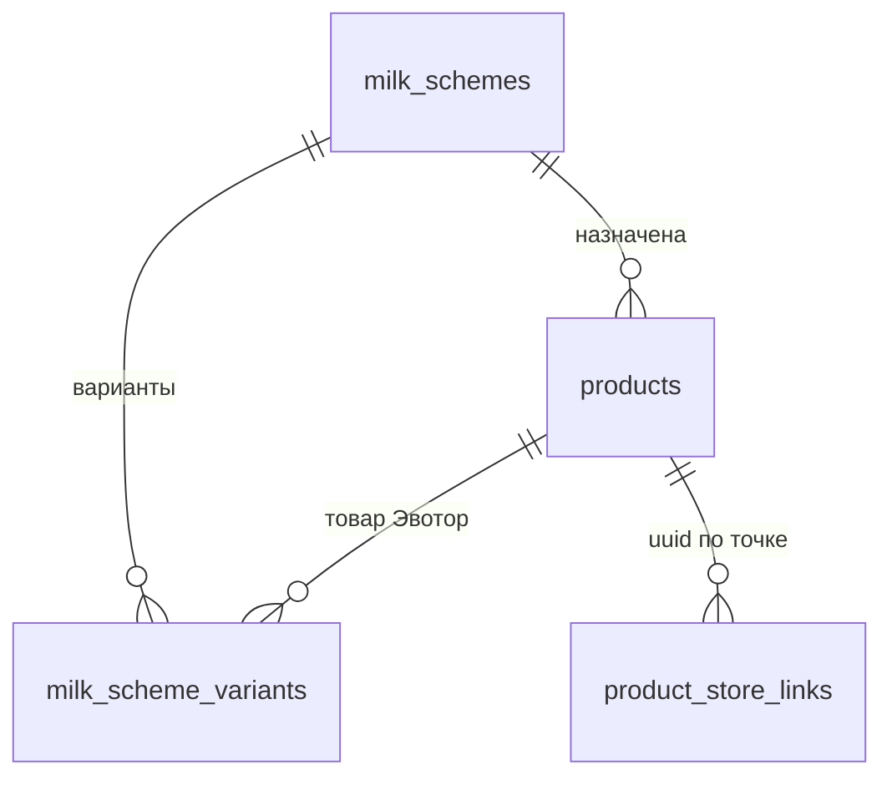

# Конфигурация товара: объёмы, молоко, добавки

## 1. Назначение

Три **независимых** набора настроек товара, которые касса получает вместе с каталогом:

| Схема | Что задаёт | Где хранится |
|---|---|---|
| Объёмы | варианты объёма как отдельные SKU Эвотор | `product_groups` + `products` (variant-строки) |
| **Молоко** | варианты молока, обычное (бесплатно, без чека) и платные (товар Эвотор) | `milk_schemes` + `milk_scheme_variants` |
| Добавки | сиропы/топпинги, лимиты, обязательность | `modifier_schemes` + `modifier_scheme_options` (без изменений) |

Молоко — **отдельная сущность**, а не часть схемы добавок: у него свои признаки (`isFree`, `isDefault`, `sendToReceipt`) и другое правило чека.

## 2. Архитектура

```mermaid
flowchart LR
  Admin[Админка · Меню] -->|POST /api/admin/milk-schemes| B[(SQLite)]
  Admin -->|POST /api/admin/products: milkSchemeId| B
  PWA[Касса APK] -->|GET /api/devices/catalog?storeUuid| B
  B -->|products[].milk| PWA
```

## 3. Схема БД



| Таблица / колонка | Тип | Смысл |
|---|---|---|
| `milk_schemes.id` | INTEGER PK | схема |
| `milk_schemes.name` | TEXT | название для админа |
| `milk_schemes.active` | INTEGER | выключенная схема не отдаётся кассе |
| `milk_scheme_variants.scheme_id` | FK → `milk_schemes.id` (CASCADE) | принадлежность |
| `milk_scheme_variants.product_id` | FK → `products.id` | товар Эвотор (UUID берётся по точке) |
| `milk_scheme_variants.label` | TEXT | «Обычное молоко», «Кокосовое» |
| `milk_scheme_variants.is_default` | INTEGER | один на схему |
| `milk_scheme_variants.is_free` | INTEGER | бесплатный вариант (обычное молоко) |
| `milk_scheme_variants.send_to_receipt` | INTEGER | пробивать отдельной позицией |
| `milk_scheme_variants.sort_order`, `active` | INTEGER | порядок и видимость |
| `products.milk_scheme_id` | INTEGER NULL | назначенная схема |

**UUID не хранится в схеме**: у товара Эвотор нет одного UUID на все магазины — он резолвится через `product_store_links (product_id, store_uuid, evotor_uuid)` для точки из запроса.

## 4. Миграция и откат

- Миграция: `backend/src/db/migrations/039_milk_schemes.sql` — аддитивная (`CREATE TABLE IF NOT EXISTS`, `ALTER TABLE … ADD COLUMN milk_scheme_id`).
- Откат: `backend/src/db/rollback/039_milk_schemes_rollback.sql` (вручную, не автоматически; `DROP COLUMN` требует SQLite ≥ 3.35 — better-sqlite3 13 подходит).
- Повторный запуск безопасен: `ensureMilkSchemeSchema()` в модуле идемпотентен для старых БД.

## 5. Правила

### Обычное молоко
- `isFree = true`, `sendToReceipt = false`, обычно `isDefault = true`;
- отображается кассиру, участвует в конфигурации, **в чек не идёт**, цену не меняет;
- даже если у него есть UUID — позиция не пробивается.

### Платное молоко
- `isFree = false`, `sendToReceipt = true`, обязателен `product_id`;
- UUID берётся из связей **этой** точки; при отсутствии — вариант помечается `available: false`, `notReadyReason: "no_evotor_uuid"` (фиктивный UUID не подставляется);
- цену и наименование касса берёт из своей номенклатуры Эвотор.

### Валидация (сервер и клиент)
- один «по умолчанию»; `isFree && sendToReceipt` запрещено; платный без товара запрещён; дубликат товара в двух вариантах запрещён; слабое имя варианта/схемы запрещено;
- удаление схемы, назначенной товарам → 409 (сначала снять назначение или выключить схему);
- права: чтение — любой админ-токен, запись — только `owner` (manager/viewer → 403).

### Формулы чека
\[
P_{\text{чека}} = P_{\text{основного товара}} + P_{\text{платного молока}} + \sum_{i=1}^{n} P_{\text{платной добавки}_i}
\qquad P_{\text{обычного молока}} = 0,\quad \text{sendToReceipt}_{\text{обычного}} = false
\]

## 6. API

| Метод | Путь | Назначение |
|---|---|---|
| GET | `/api/admin/milk-schemes` | список схем с вариантами и `usedByProducts` |
| POST | `/api/admin/milk-schemes` | создать/обновить (`{ id?, name, active, variants[] }`), варианты заменяются целиком |
| DELETE | `/api/admin/milk-schemes/:id` | удалить (409, если назначена товарам) |
| POST | `/api/admin/products` | `milkSchemeId` (число — назначить, `null` — снять, отсутствует — не менять) |
| GET | `/api/devices/catalog?storeUuid=` | `products[].milkSchemeId`, `products[].milk[]` |

### Пример ответа каталога (фрагмент)

```json
{
  "id": 42,
  "name": "Капучино",
  "milkSchemeId": 3,
  "milk": [
    { "id": 11, "productId": null, "label": "Обычное молоко", "evotorUuid": null,
      "isDefault": true, "isFree": true, "sendToReceipt": false, "sortOrder": 0,
      "active": true, "available": true, "notReadyReason": null },
    { "id": 12, "productId": 57, "label": "Кокосовое молоко", "evotorUuid": "8f1c…",
      "isDefault": false, "isFree": false, "sendToReceipt": true, "sortOrder": 1,
      "active": true, "available": true, "notReadyReason": null }
  ],
  "toppings": []
}
```

Пустая схема / отсутствие схемы → `milk: []` (не ошибка). Неактивные схемы и варианты не отдаются.

## 7. Обработка ошибок

| Код | Когда |
|---|---|
| 400 | нарушено бизнес-правило (текст по-русски), некорректный id |
| 403 | запись не владельцем |
| 409 | удаление схемы, назначенной товарам |
| 200 | успешное создание/обновление/удаление |

## 8. Совместимость с APK

- Поля `milkSchemeId` и `milk` — аддитивные; старый APK их игнорирует (как и `sellable`).
- Отсутствие `milk`/пустой массив = «схемы нет», ошибок не вызывает.
- Контракт схем согласуется с APK-агентом; имена полей стабильны: `label`, `evotorUuid`, `isDefault`, `isFree`, `sendToReceipt`, `sortOrder`, `active`, `available`.
- Порядок обновления: backend → проверка JSON на тестовой карте → APK.

## 9. Инструкция администратора

1. «Меню → Схемы молока» → «Новая схема молока».
2. Заполнить название; у вариантов задать признаки:
   - **Обычное молоко**: «По умолчанию» + «Бесплатный (не в чек)»;
   - **Платное**: снять «Бесплатный», оставить «Передавать в чек», выбрать товар Эвотор.
3. Сохранить.
4. В карточке товара поле **«Схема молока»** → выбрать схему (независимо от «Схема добавок»).
5. Снять назначение — выбрать «Без схемы молока».

## 10. Инструкция тестирования

- backend: `cd backend && DB_PATH=/tmp/milk.db npx vitest run milk-scheme` (17 тестов).
- админка: `cd frontend-admin && npx vitest run milkScheme`.
- каталог: `curl -s 'http://localhost:3000/api/devices/catalog?storeUuid=<uuid>' | jq '.products[] | select(.milkSchemeId) | {name, milk}'`.
- ожидаемо: обычное молоко `isDefault:true, isFree:true, sendToReceipt:false, evotorUuid:null`; платное — `evotorUuid` точки.

## 11. Изменённые файлы

| Файл | Что |
|---|---|
| `backend/src/db/migrations/039_milk_schemes.sql` | таблицы + колонка |
| `backend/src/db/rollback/039_milk_schemes_rollback.sql` | откат |
| `backend/src/modules/catalog/milkScheme.ts` | модель, валидация, CRUD, резолв для каталога |
| `backend/src/modules/admin/routes.ts` | API схем, `milkSchemeId` в товаре, права |
| `backend/src/modules/devices/routes.ts` | `milkSchemeId` + `milk[]` в каталоге |
| `backend/src/__tests__/milk-scheme.test.ts` | 17 тестов |
| `frontend-admin/src/pages/MenuGroups.tsx` | вкладка «Схемы молока» |
| `frontend-admin/src/lib/milkScheme.ts` (+ `.test.ts`) | черновик и валидация |
| `frontend-admin/src/pages/MenuProducts.tsx` | поле «Схема молока» |
| `frontend-admin/src/pages/Menu.tsx`, `api/types.ts` | вкладка и типы |

## 12. Известные ограничения

- Объёмы по-прежнему живут в `product_groups` (отдельной «схемы объёмов» не создавали — существующая модель сохраняется целиком).
- UUID варианта молока не кешируется в схеме: при смене привязки товара к точке каталог отдаёт актуальный.
- Платный вариант без UUID не скрывается, а помечается `available:false` — касса решает, показывать ли его с пометкой.
- Массового назначения схемы молока группе товаров нет (только по одному товару).

## 13. Аргументация архитектуры

| Решение | Почему принято | Альтернативы | Риски |
|---|---|---|---|
| Молоко — отдельные таблицы, а не `modifier_scheme_options` | разные признаки (`isFree`, `sendToReceipt`) и правило «обычное не в чек»; смешение сломало бы лимиты и группы добавок | JSON в `products`; поле в схеме добавок | +2 таблицы и второй CRUD |
| UUID не хранить в варианте | UUID различается по магазинам (`product_store_links`) | хранить uuid в варианте | при копировании схемы между точками нужен ручной резолв (решается запросом) |
| Назначение — `products.milk_scheme_id` | минимальная связь 1:N без join-таблицы; «снять» = NULL | отдельная `product_milk_schemes` | нет истории переиспользования схемы между товарами (не требуется) |
| Отдавать молоко внутри `/api/devices/catalog` | касса уже берёт конфигурацию оттуда; второй канал запрещён ТЗ | отдельный endpoint `/configuration` | размер ответа немного растёт |
| Клиентская валидация дублирует серверную | ошибка видна до сохранения, UX | только сервер | дублирование правил (тесты фиксируют паритет) |
